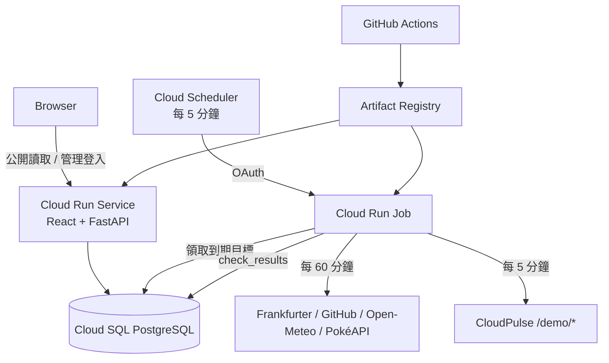
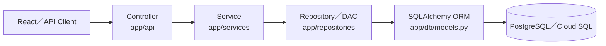

# 架構與資料流

## 後端分層架構

FastAPI 後端採用與 Java `Controller → Service → DAO` 相同責任方向的分層式模組化單體；Python 程式中將 DAO 命名為 Repository。HTTP 請求不得略過中間層直接存取資料庫。

各層責任如下：

- **Controller（API）**：宣告路由、接收並驗證 HTTP 輸入、執行登入與 CSRF 等 HTTP 邊界檢查、呼叫 Service，並把應用程式錯誤轉換成既有 HTTP 狀態碼與回應 DTO。
- **Service**：執行 Monitor 建立、更新、軟刪除、週期限制、核准模板、總覽統計、登入 Session 與監測結果排程等商業流程；寫入流程的交易邊界也位於此層。
- **Repository／DAO**：集中 SQLAlchemy 查詢、鎖定、新增、刪除、`flush` 與 `refresh` 等持久化細節，向 Service 回傳 ORM Entity 或查詢結果。
- **SQLAlchemy／PostgreSQL**：ORM Entity、Constraint、Index、唯一鍵與實際資料保存；正式環境使用 Cloud SQL for PostgreSQL。

### Composition 與依賴注入

Web 請求由 FastAPI Dependency Injection 透過 `get_db` 建立 request-scoped SQLAlchemy Session。Composition root／依賴工廠以同一個 Session 依序組裝 Repository，再注入 Service，最後交給 Controller 使用。同一個請求中的驗證與商業操作共享 Session，但 Controller 不知道 SQLAlchemy 查詢細節。這也允許測試以替代 Session、Repository 或 Service 驗證各層，而不需要連線正式 Cloud SQL。

Cloud Run Monitor Job 沒有 HTTP request scope，因此由 `app/jobs/monitor_runtime.py` 以 `SessionLocal` 組裝 Repository 與 `MonitorExecutionService`；Web 與 Job 共用相同分層原則，但各自管理資料庫生命週期。

### Transaction boundary

- Repository／DAO 可以查詢、鎖定、修改及 `flush`，但不自行 `commit` 或 `rollback`。
- Service 以一個完整 use case 為交易單位。Web Service 透過注入的 commit callback 在成功後只提交一次；Job 則由外層短交易 context 在 Service 成功返回後提交，例外時自動 rollback。
- 純讀取流程不提交交易；Session 在 request 或 Job transaction 結束後由外層關閉。
- Monitor 建立、更新、軟刪除與還原都維持原子性；軟刪除不移除既有 `check_results`。
- 資料庫 Constraint 與 `(execution_id, monitor_id)` 唯一鍵仍是最後一道一致性防線，不能只依賴 Service 驗證。

### 各層禁止事項

| 層級 | 禁止事項 |
| --- | --- |
| Controller | 不得撰寫 SQLAlchemy `select`／`execute`、不得直接操作 ORM Entity、不得自行 `commit`。 |
| Service | 不得組合 SQL 查詢、不得依賴 FastAPI `Request`／`Response`／`HTTPException`、不得把 HTTP 狀態碼當作商業規則。 |
| Repository／DAO | 不得包含週期限制、模板核准、429 退避或狀態判定等商業規則；不得回傳 HTTP Response；不得自行決定交易提交。 |
| ORM／Database | 不負責 HTTP 流程或排程協調；只表達持久化模型與資料完整性約束。 |

這次分層重構只重新配置程式責任，不變更公開 API 路徑、Request／Response Schema、HTTP 狀態碼、Cookie／CSRF 契約、資料表、Alembic Migration 或既有資料。React、Terraform、Cloud Run、Cloud SQL、Scheduler 與 Secret Manager 的介面也維持不變。

### Monitor Job 的 Claim／Probe／Save 邊界

監測工作刻意拆成三個階段，避免在外部 HTTP 請求期間占用長交易或資料列鎖：

1. **Claim**：Job 執行器開啟短交易，`MonitorExecutionService` 呼叫 Repository 以 `FOR UPDATE SKIP LOCKED` 領取到期 Monitor，寫入 `claimed_execution_id` 與租約後立即提交。
2. **Probe**：離開資料庫交易後，以最多四個並行 HTTP 請求執行連線、內容、Schema、業務規則與 Latency 驗證。此階段不持有資料庫鎖。
3. **Save**：每筆結果各自在短交易內重新鎖定 Monitor，確認 Claim 仍屬於相同 execution，原子寫入 `check_results`、計算 `next_check_at`／429 退避並清除租約；Claim 已過期或被取代時不寫入。

## 排程與冪等性

Scheduler 只啟動 Job。Job 在短交易內以 `FOR UPDATE SKIP LOCKED` 選取 `next_check_at <= now()` 且沒有有效租約的目標，寫入 `claimed_execution_id` 和兩分鐘租約後才離開交易並發送 HTTP。

MOCK 的 `next_check_at` 會對齊 Scheduler 的五分鐘刻度。例如 15:20:23 完成後，下一次排在 15:25:00，避免 15:25 的 Job 因幾秒之差略過目標。REAL 仍以實際完成時間計算 60 分鐘週期與 429 漸進退避，避免提早呼叫外部 API。

結果只能由持有相同 Claim 的執行寫回；`check_results(execution_id, monitor_id)` 另有唯一鍵。同一個 Job 內最多四個請求並行，Cloud Run Job 本身固定單 Task、單 Parallelism。程序在寫回前中止時，租約到期後目標可被下一輪重新領取。

## 判定順序

1. Connection／Timeout；
2. HTTP 429；
3. 預期 HTTP Status；
4. JSON Content-Type；
5. JSON 解碼與必要欄位；
6. 業務值；
7. Latency。

Frankfurter 日期落後只寫入 `DATA_DATE_NOTE` 或 `STALE_DATA`，不覆蓋正常的 UP／DEGRADED 判定。HTTP 429 會產生 `RATE_LIMITED` 並將 REAL 目標退避到 2、4、8 小時，最高 24 小時。

## 安全邊界

- Target URL 由 `target_key` 對應的程式內模板產生；執行前再次比對精確 URL。
- Production 不跟隨 Redirect，只使用 HTTPS；本機 Mock 唯一允許設定中的 Compose HTTP URL。
- 不保存完整 Response Body、Token、認證 Header 或 Query Secret。
- 公開 API 全為非敏感讀取；管理寫入需有效 Session、CSRF Cookie/Header 與允許 Origin。
- Cloud Run Runtime、Scheduler、GitHub Deploy 使用三個獨立 Service Account。

