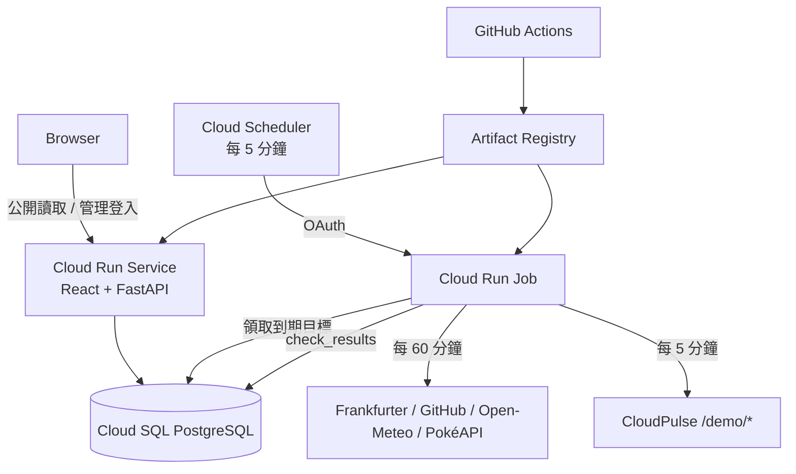

# 架構與資料流

## 排程與冪等性

Scheduler 只啟動 Job。Job 在短交易內以 `FOR UPDATE SKIP LOCKED` 選取 `next_check_at <= now()` 且沒有有效租約的目標，寫入 `claimed_execution_id` 和兩分鐘租約後才離開交易並發送 HTTP。

MOCK 的 `next_check_at` 會對齊 Scheduler 的五分鐘刻度。例如 15:20:23 完成後，下一次排在 15:25:00，避免 15:25 的 Job 因幾秒之差略過目標。REAL 仍以實際完成時間計算 60 分鐘週期與 429 漸進退避，避免提早呼叫外部 API。

結果只能由持有相同 Claim 的執行寫回；`check_results(execution_id, monitor_id)` 另有唯一鍵。同一個 Job 內最多四個請求並行，Cloud Run Job 本身固定單 Task、單 Parallelism。程序在寫回前中止時，租約到期後目標可被下一輪重新領取。

## 判定順序

1. Connection／Timeout；
2. HTTP 429；
3. 預期 HTTP Status；
4. JSON Content-Type；
5. JSON 解碼與必要欄位；
6. 業務值；
7. Latency。

Frankfurter 日期落後只寫入 `DATA_DATE_NOTE` 或 `STALE_DATA`，不覆蓋正常的 UP／DEGRADED 判定。HTTP 429 會產生 `RATE_LIMITED` 並將 REAL 目標退避到 2、4、8 小時，最高 24 小時。

## 安全邊界

- Target URL 由 `target_key` 對應的程式內模板產生；執行前再次比對精確 URL。
- Production 不跟隨 Redirect，只使用 HTTPS；本機 Mock 唯一允許設定中的 Compose HTTP URL。
- 不保存完整 Response Body、Token、認證 Header 或 Query Secret。
- 公開 API 全為非敏感讀取；管理寫入需有效 Session、CSRF Cookie/Header 與允許 Origin。
- Cloud Run Runtime、Scheduler、GitHub Deploy 使用三個獨立 Service Account。

